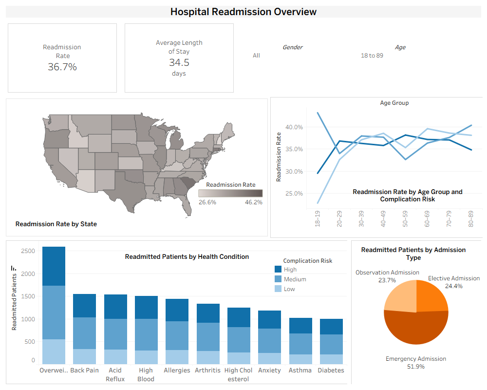

# Hospital Readmission Dashboard 

## Business Problem

The Centers for Medicare & Medicaid Services (CMS) penalizes hospitals with too many readmissions, meaning patients who return within 30 days of discharge. A large hospital chain with patients across nearly every U.S. state needs to understand what is driving its readmissions in order to reduce penalties and improve patient outcomes.

Executive leaders without a technical background need a way to explore the data on their own: where readmissions are concentrated, which patient groups are most affected, and how readmissions relate to the way patients were admitted. Those insights support decisions like improving discharge planning, strengthening post-discharge care, and targeting patient support programs.

## Audience

| Leader | Focus |
|---|---|
| Senior Vice President of Hospital Operations | Demographic and regional trends in patient outcomes |
| Executive Vice President of Research | Patterns in demographics, medical conditions, and hospital procedures |
| Chief Medical Officer | How readmission rates relate to demographics, conditions, and treatment |

## Data

Medical readmission dataset provided for the course: 10,000 patients and 50 variables covering demographics, hospitalization details, health conditions and risk factors, and patient survey responses. A patient is counted as readmitted if they returned to the hospital within 30 days of discharge.

## How the Dashboard Addresses It

- **KPIs:** overall readmission rate and average length of stay, a baseline to compare every filtered view against
- **Readmission rate by state:** identifies regions above or below the overall rate
- **Readmitted patients by health condition and complication risk:** shows which conditions account for the most readmissions
- **Readmission rate by age group and complication risk:** compares demographic and clinical risk patterns
- **Readmitted patients by admission type:** shows how readmitted patients were originally admitted
- **Age and gender filters:** apply to every chart and KPI, so leaders can focus on specific patient groups

All charts use colorblind-friendly palettes.

## Tools

Tableau

To explore the dashboard interactively, download `Tableau Workbook.twbx` and open it in Tableau Desktop or the free Tableau Public app.
